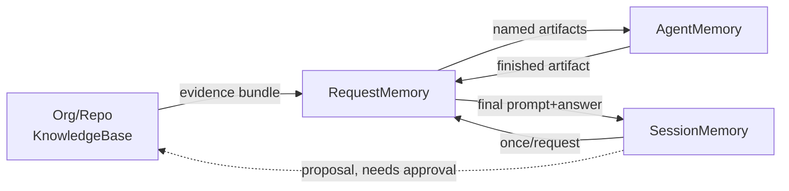

# DR-004: Bounded Memory Architecture — Two Knowledge Stores, Three Execution-Memory Scopes

- **Status:** Accepted
- **Date:** 2026-08-29
- **Decision owners:** AutoSE maintainers
- **Scope:** `src/logic/common/` memory management and knowledge retrieval, all tiers and stages

## Context

Agentic coding tools tend to accumulate one ever-growing shared transcript across a whole session, or, in multi-stage workflows, across every stage of a single request — causing context bloat, degraded model attention, and duplicated content (a design doc re-appearing as a chat message in addition to being a canonical artifact).

A design-producing stage also needs durable knowledge beyond any single session: organizational standards (domain language, approved technology, governance/compliance requirements) and repository-specific knowledge (prior decisions and conventions, plus operational facts learned while working in the repo — a working build/test command, a confirmed convention, a documented pitfall). Leaving discovery to ad hoc prompt instructions makes capture accidental and gives a later verification stage no way to check whether a cited rule was real or fabricated. Without a durable, repo-scoped store, every new session re-derives already-learned facts, or repeats a mistake a prior session already resolved.

The root cause is conflating two different kinds of state — durable knowledge ("what is true/known", independent of any session) and transient execution memory ("what a bounded unit of work needs right now") — each of which further splits by scope:

- **Durable knowledge:** `OrgKnowledgeBase` (org-wide, human-owned, read-only at runtime) and `RepositoryKnowledgeBase` (repo-wide, persists indefinitely across sessions; partly human-curated, partly harness-writable under approval).
- **Execution memory:** `SessionMemory` (one interactive session), `RequestMemory` (one user prompt), `AgentMemory` (one agent call, discarded on return).

Runtime configuration (model/provider settings) is a different concern with a different owner and lifetime than organizational standards content, and the two must not share a config file.

## Decision

Two durable knowledge stores and three execution-memory scopes, with a strict, one-directional flow between them:

- **`OrgKnowledgeBase`** — company/team standards, read from a recognized local directory or configured pointer, kept separate from runtime inference config. Read-only at runtime: updated only by humans, out-of-band.
- **`RepositoryKnowledgeBase`** — this repository's own store. Holds curated knowledge (decision records, architecture docs — human-authored via normal contribution per DR-001) and agent-maintained **operational entries** (a verified command, a confirmed convention, a documented pitfall), writable by the harness/model only under human approval. A notable operational entry should be promoted into a proper Decision Record instead of staying only here.
- **`SessionMemory`** — created once per session. Holds a rolling, bounded conversation history. Never sees raw tool-call transcripts or full per-stage artifacts.
- **`RequestMemory`** — created once per prompt, discarded on completion. Holds canonical artifacts (e.g. `artifacts["design_doc"]`), the request's evidence bundle, and any per-request budgets/ledger.
- **`AgentMemory`** — created fresh per agent `run()` call, discarded on return, even across a loopback re-invocation. Holds that call's live messages and tool-round bookkeeping only.

**Bounds and overflow.** Every scope has a hard cap and fails explicitly on overflow rather than growing unbounded. `SessionMemory` keeps the last few raw `(prompt, answer)` exchanges verbatim plus one rolling, LLM-compressed summary capped at a fixed size; if compression fails, the oldest raw exchange is dropped (logged, not silent) rather than retried indefinitely. `RequestMemory` artifact slots and its evidence bundle are size-capped per each stage's prompt contract (see DR-003): an oversized artifact is a **stage failure** (loopback, per a fail-closed validation pattern), never silently truncated, and a full evidence bundle rejects further follow-up retrieval rather than evicting already-cited items. `AgentMemory` is bounded by the existing per-call context budget and tool-output caps.

**Artifact ownership.** An artifact has exactly one canonical owner at a time — `RequestMemory`, until explicitly promoted. Rendering an artifact into a prompt for an agent call is an ephemeral projection that lives only in that call's `AgentMemory`; it is never written back as a second canonical copy.

**Operational entries.** Each entry records its content, provenance (session/stage that produced it), how it was verified (e.g. command exit code, test pass, human confirmation), the repository revision and branch it was verified against, and a status (`proposed` / `approved` / `rejected` / `superseded`). An entry is retrievable only if its revision is an ancestor of the session's current checkout — otherwise it's treated as stale for that session, not deleted or silently applied. Promotion follows a proposal → human approve/reject → commit protocol: nothing joins the durable store until an approval is recorded (approver identity + timestamp); an approved correction supersedes the old entry rather than overwriting it silently.

**Evidence.** An evidence item's ID is derived from its content hash and the repository revision/org-pack version it came from, not just its source path, so the same path at a different revision yields a different ID. Follow-up search results are appended to the same request-scoped bundle the verification stage later reads, never a separate structure. Relevance score and other retrieval-time metadata are kept separate from, and never used to invalidate, an item's stable identity. Retrieved knowledge and tool output are evidence, not instructions: rendered as clearly delimited, untrusted material that can never alter tool permissions, stage routing, or approval requirements. Any claim asserting an Org/Repo-grounded origin must cite its evidence ID; `src/logic/` checks the citation resolves to a real bundle item the same way a requirements ledger's IDs are checked, and an unresolved or malformed citation is a stage failure. When Org and Repo evidence conflict on a governance/compliance matter, Org wins outright; otherwise Repo wins but the design must cite and flag both rather than picking one silently.

**Promotion.** Adjacent-scope only, final-state only: `AgentMemory` → `RequestMemory` overwrites its artifact slot (last write wins) but keeps a small, bounded retry digest (attempt count plus a short feedback summary per recent attempt) instead of the discarded prior artifact, so a retried stage has precise recent context without a full intermediate copy. `RequestMemory` → `SessionMemory` distills to the final `(prompt, answer)` pair; intermediate loop state is never promoted. `SessionMemory` → `RepositoryKnowledgeBase` is the one non-automatic hop, gated by the approval protocol above.

## Consequences

### Positive

- No duplicate content growth: a canonical artifact is never also carried as a parallel chat message.
- Makes it structurally impossible for a tool-call transcript to leak into long-term session memory.
- Every scope has an explicit bound and a defined, testable overflow behavior, not just an implied "keep it small."
- Operational facts learned in one session are available to later sessions via `RepositoryKnowledgeBase` instead of being re-derived every time.
- Knowledge use in design decisions is explicit, cited, and checkable — a verification stage can catch a fabricated or stale citation.
- Human approval plus revision-reachability checks keep a wrong "learned" fact, or one from a divergent branch/worktree, from silently corrupting future sessions.
- A loopback re-invocation starts with a clean `AgentMemory`, avoiding stale reasoning from a prior attempt bleeding into the retry.

### Negative

- Touches every agent, runner, and client adapter — a wide, mechanical piece of work to introduce consistently.
- `RepositoryKnowledgeBase`'s operational subset needs a concrete storage decision (e.g. gitignored local cache vs. committed file) for concurrent-branch writes, as follow-up implementation work.
- Adds a few fixed contracts (entry fields, evidence ID format, citation marker) that every stage touching them must honor exactly, similar in spirit to a requirements ledger's fixed format.
- Lexical-only retrieval (Phase 1) may miss relevant material; follow-up search only partly compensates.
- The approval step (who approves, and where) must actually be implemented, or the harness/model has no path to persist learned facts at all.

## Alternatives considered

### One shared mutable "blackboard" transcript across all stages

Rejected as the primary mechanism. It recreates the duplication and context-bloat problem this decision exists to prevent as workflows grow. A bounded, artifact-only shared object equivalent to `RequestMemory` is acceptable; an open-ended shared message transcript is not.

### Single unified memory object with scope tags per entry

Rejected. A tag is a runtime convention that can be violated accidentally by future code; distinct types make an illegal cross-scope read a structural mistake instead.

### Summarize state between every stage transition instead of restructuring its shape

Rejected for the general case. It adds inference cost and lossy summarization exactly where information (e.g. a design document) needs to stay exact.

### Extend `SessionMemory` to simply never be discarded

Rejected. Recreates the unbounded, ever-growing transcript problem and conflates rolling history with a small set of durable, distilled facts.

### Record every learned fact as a new Decision Record

Rejected as the sole mechanism. DR-001's bar is for notable, human-reviewable decisions; too heavyweight for a small operational fact like "this is the test command." `RepositoryKnowledgeBase` handles the lightweight case, with an escalation path to a DR when warranted.

### Keep organizational rules inside general runtime configuration

Rejected. Different owners, lifetimes, and access concerns; conflating them makes both harder to manage correctly.

### Rely only on prompt-directed ad hoc file discovery

Rejected. The status quo problem — discovery is non-deterministic and gives no provenance or absence signal for verification to check against.

### Store full retrieved source documents in shared request state

Rejected. Conflicts with keeping request state bounded and artifact-centric; a capped, cited evidence bundle is sufficient for provenance and verification.

### Let the harness/model write to `RepositoryKnowledgeBase` without human approval

Rejected. An unreviewed write path lets a wrong or manipulated "learned" fact silently become trusted context for every future session.

### Carry a full change/diff log upward across scopes instead of only the final state

Rejected. Retaining every loop iteration's artifact reintroduces unbounded growth; only each scope's final state is promoted, with an explicit supersession record for corrections.

### Collapse to a generic "external knowledge retrieval" tool plus only the three execution scopes

Rejected. An undifferentiated retrieval tool has no schema for provenance, verification, approval, or revision-scoping, and erases the distinction between human-controlled Org standards, human-approved Repository knowledge, and ordinary untrusted tool output.
